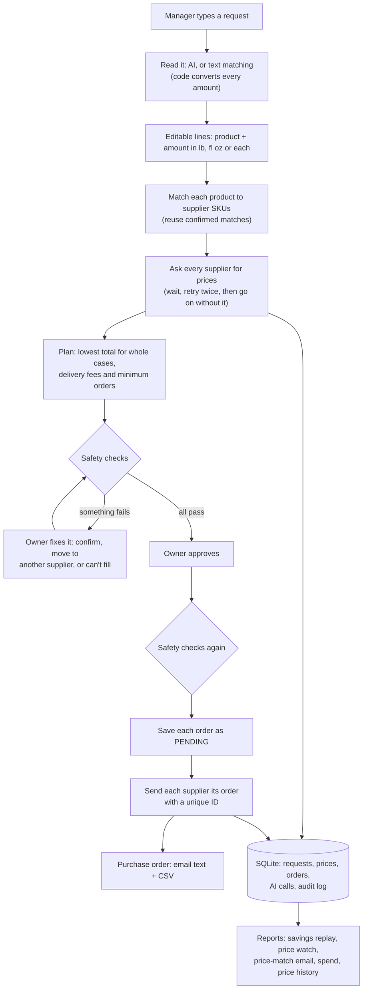

# Wishing Cup purchasing

A manager types what a cafe or the factory needs. The app asks four suppliers for prices, works out
the cheapest real cost (whole cases, delivery fees, minimum orders) and makes a shopping list per supplier.
The owner checks and approves; the app places the orders and keeps everything for reports.

> **All supplier prices, products and order confirmations are fake test data.** No real supplier is
> contacted and nothing is scraped.

## Run it

Python 3.11. Two commands:

```
pip install -r requirements.txt
python run.py
```

The app opens at http://localhost:8501. It works with no AI key: it reads requests with plain text
matching. The first start creates the database and loads the fake data.

## A short walkthrough

1. **New request.** Pick Factory, press **Load example**, then **Read request**. The message is split into
   lines, each converted to lb, fl oz or each, in a table you can edit. "Some saffron" is listed as
   unclear: we don't sell it, and the app never makes a product up. Press **Get prices**.
2. **Review and approve.** The price table shows every item at every supplier as the real cost of the
   whole cases you'd buy, the cheapest in green. PFG's heavy cream shows "don't use": its price came back
   as $0.00. Below are plans a (cheapest per item, ignoring minimums), b (one supplier) and c (best
   overall), with what c saves; the list for each supplier; the items that need a person; and the
   safety checks. Press **Confirm all**, then **Approve and place orders**.
3. **Orders.** Each supplier's order is confirmed. Download the purchase order as email text or CSV.
4. **Reports.** Press **Match every product now** once. Then see what the app would have saved on the last
   8 weeks of orders, which prices rose everywhere versus at one supplier, a price-match email for Sysco,
   spend by supplier and location, and each ingredient's price over time.

Then try the same with Sysco and the AI switched off in the sidebar.

## Assumptions

- Four suppliers: Sysco, US Foods, PFG and **Supplier 4, which is a placeholder** for a local supplier.
  Each has its own minimum order, delivery fee, delivery days, lead time and locations (config.yaml).
- **A manager makes the request; the owner approves it.** Nothing is ordered without the owner.
- **Prices are fake**, generated from a fixed seed, so the numbers are the same on every run and machine.
- **Placing an order makes a purchase order** as email text and a CSV, saved in `data/purchase_orders/`.
  The fake suppliers also "confirm" each order so the whole flow can be tested.
- Sysco is the main supplier (the one the business buys from today, and the one price-match emails go to).
- Dates are Boston time. Money is kept in whole cents and amounts as exact decimals, never floats.

## How it works



The AI is only used for messy text: reading the manager's message, picking which supplier product is
the same ingredient, and reading pack sizes like "4/32 OZ". Code does all the math, picks the plan
and places the orders, and every AI answer is checked before it is used.

## Safety features, and how to see each one

The sidebar has switches for the fake problems: each supplier can be **down**, **slow** or **flaky**,
and the **AI can be down**. They last for your browser session; config.yaml sets where they start.

| Safety feature | How to see it |
|---|---|
| A supplier doesn't answer: wait, try 2 more times, then plan from the others with a warning | Switch **Sysco: down**, make a request. The plan leaves Sysco out and the warning lists the items Sysco was cheaper for last time. |
| A slow supplier | Switch **slow**: each answer takes 1 second, under the 2-second limit. Set `slow_seconds: 3` in config.yaml to make it time out and count as no answer. |
| A supplier that fails sometimes | Switch **flaky**: 30% of calls fail and the retries usually recover. If an order still fails it stays PENDING; **Send the waiting orders now** (Orders page) or the next start finishes it. |
| An order is never placed twice | Every order is saved as PENDING before any supplier hears of it, with a unique ID (request + supplier). A supplier given the same ID twice returns the same confirmation. Double-clicking Approve does nothing the second time. The app being stopped mid-order is simulated by `pytest -k stop_after`. |
| The AI is down, or there is no key | Switch **AI is down**. Requests are read by text matching; anything unsure goes to "unclear" or "needs a person". |
| AI answers are checked; one retry, then text matching | Every answer must fit a schema. A product code or SKU that wasn't offered is refused, the model is told why and gets one more try, then text matching takes over and the item is marked for a person (`pytest tests/test_intake.py tests/test_matching.py`). |
| A model that hasn't passed the tests | Put a key in .env without running the AI tests: the sidebar says **model not tested** and every AI answer needs a person. |
| A price of $0 or one that moved more than 50% since last week is not used | Built into the fake data: PFG's heavy cream ($0.00, in the factory example) and Supplier 4's vanilla (+70%; ask Court St Cafe for "16 fl oz vanilla extract") show as "don't use" in the price table. |
| Out of stock | Sysco's matcha (cafe example) is out of stock and marked in the price table. |
| A quantity over 3x the most this location ever ordered needs a person | Type "650 lb unsalted butter" for the Factory. |
| Prices older than 24 hours block approval | `pytest -k old_prices`, or set `price_max_age_hours: 1` and wait an hour. **Get fresh prices** fixes it. |
| Every item is on one list or "can't fill"; cases cover the need; totals add up; minimums met; delivery in time | The checklist on the Review page. Move items off PFG until its order is under its $750 minimum: Approve is blocked, with the reason. |

Every check runs before approval and again just before ordering, and any failure blocks with a reason
in plain words.

## Trade-offs we made

- **SQLite on one laptop.** No setup and nothing to host, but one machine and one writer at a time.
- **Fake suppliers behind a real interface.** The whole flow can be tested today; a real supplier is a new class.
- **Cautious text matching.** It would rather ask a person than guess, so with no AI more items need a look.
- **Whole cases, one SKU per item per supplier.** It doesn't mix a 50 lb and a 25 lb bag of the same flour.
- **Minimum orders count the items, not the delivery fee.**
- **A "jump" is 50% up or down.** A price that halves is as likely a data error as one that doubles.
- **Fresh prices mean a fresh plan,** so the owner's moves are redone after a price refresh.
- **Suppliers are asked one after another.** Simple and predictable, but a slow supplier slows the page.
- **Reports use only confirmed product matches.** Fewer numbers at first, but no numbers about the wrong product.
- **The best plan is exact** (an integer program solved by PuLP) with a 10-second limit and a simple fallback.

## Changing the AI model

1. Edit the three lines in `.env` (copy `.env.example` first). Any OpenAI-style endpoint works:
   ```
   LLM_BASE_URL=https://api.openai.com/v1      # or https://openrouter.ai/api/v1, or http://localhost:11434/v1 for Ollama
   LLM_API_KEY=...
   LLM_MODEL=...
   ```
2. **Run the AI tests before relying on it:** `python -m evals.run`. It runs the 30 cases in
   `evals/cases.json` (15 request readings, 15 product matches), prints the score and time per task and
   every failure, and saves `evals/results/<model>.json`.
3. If every task scores at least 0.9 (`eval_threshold`), the sidebar shows the model as passed. Until then
   it shows **model not tested** and every AI answer needs a person. Changing a prompt in
   `app/llm/prompts/` or a test case resets this.

`pytest` never uses the AI, so it can run anywhere.

## Adding a supplier

One new class and one config entry.

1. Write a class with three functions (see `app/suppliers/base.py`): `get_catalog()`, `get_quotes(skus)`
   and `place_order(order, order_id)`, which returns a confirmation id. `place_order` must return the same
   confirmation if it sees the same `order_id` again; that is what makes ordering safe to retry.
2. Add the supplier to `suppliers:` in config.yaml with its terms, and point it at the class:
   ```yaml
   - code: acme
     name: Acme Foods
     min_order_cents: 30000
     delivery_fee_cents: 2000
     delivery_weekdays: [Mon, Thu]
     lead_time_days: 2
     serves_locations: [court_st, factory]
     sales_rep: {name: Pat Lee, email: pat@acme.example}
     connector: app.suppliers.order_guide:OrderGuideSupplier
     connector_settings: {order_guide: order_guides/acme.csv, outbox: outbox/acme}
   ```

`app/suppliers/order_guide.py` is a working example: it reads a price list exported from the supplier's
website and writes each order to an outbox folder.

## Connecting real supplier prices later

Each route below becomes one class with the same three functions:

- **EDI.** An 832 (price/sales catalog) feeds `get_catalog` and `get_quotes`; an 850 (purchase order) is
  `place_order`, with our order ID as the PO number so a resend can't double-order; the 855
  acknowledgment is the confirmation. Usually through an EDI provider. Ask each supplier's rep what they support.
- **Supplier partner APIs.** If a distributor offers an ordering API to customers, the class calls it,
  again sending our order ID so retries are safe.
- **Exported order guides.** Most ordering websites can export your usual items with current prices.
  `OrderGuideSupplier` already reads these, and dates the prices by the file, so an old export is caught
  by the 24-hour rule.
- **Email orders.** The app already writes each purchase order as email text and CSV; a person sends it.
  Reading the supplier's reply would be the next step.

## Growing to 10 cafes and the factory

- Add each cafe under `locations:` in config.yaml and to each supplier's `serves_locations`.
- Each location's request is planned on its own, because minimums and delivery fees apply per delivery.
- Order history and the "3x the most ever ordered" check are per location; prices and product matches are
  shared, so each product only needs matching once for everyone.
- The owner sees every location's requests on one Review page.
- SQLite is fine for a few dozen requests a week from one office machine. When several people use it
  from different computers, host it and move to Postgres (with SQLModel that is mostly a connection
  string), and add logins so managers request and only the owner approves.
- Once there are many cafes, combine their orders (see next steps) to meet minimums more easily.

## Limits

- The suppliers, prices and confirmations are fake. Nothing real is ordered.
- No logins or roles: the approver is just a name.
- One machine (SQLite); not built for many people at once.
- Suppliers are asked one at a time; there is no background job for retries besides the start-up check.
- No partial cases, substitutions, taxes, deposits or fuel surcharges.
- 30 AI test cases is a small set; a model that passes them can still make mistakes, which is why
  checks and a person stay in the loop.
- Text matching misses heavy abbreviations ("UNSLTD BTR"); those go to a person.
- Boston time and US dollars only.

## Next steps

- **Check invoices against orders** (price, cases, what arrived) and send the result to bookkeeping.
- **Combine orders across locations** into one delivery where that meets a minimum or saves a fee.
- **Read a photo of the handwritten order sheet**, feeding the same checks as typed requests.
- **Approve from Slack or a text message**, with the same checks and one-time order IDs.

## Tests

```
pytest
```

Runs everything with no AI key, including clicking through the app with Streamlit's test runner and
starting it from scratch. GitHub Actions runs it on Ubuntu, macOS and Windows with Python 3.11
(`.github/workflows/tests.yml`). `python scripts/walkthrough.py` shows the whole flow in the terminal,
once with every fake problem off and once with Sysco and the AI down.

## Where things are

```
run.py                 start here
config.yaml            suppliers, locations, limits, fake-problem switches (money in cents)
.env                   AI settings only
app/                   the logic: reading, matching, units, pricing, plans, checks, orders, reports
app/llm/               AI client and prompts (plain text files)
app/suppliers/         the supplier interface, the fake suppliers, the order-guide connector
ui/                    the Streamlit pages
evals/                 AI test cases, the scorer, saved results
tests/                 pytest
SPEC.md                the original brief
```
